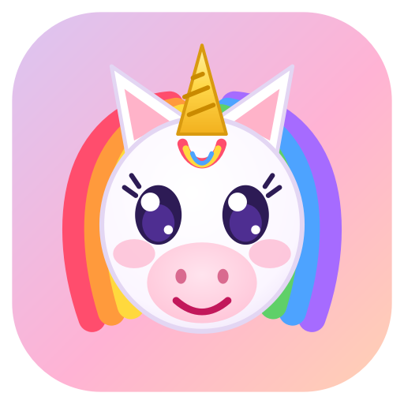

  

<h1 align="center">Unicorns Can Talk</h1>

<b>Talk. It types.</b> 
Making Unicorns Talk Since 2026 - Dictation &amp; Live Transcription

  <a href="https://unicorns-can.talk">Website</a> ·
  <a href="https://unicorns-can.talk/docs">Guide</a> ·
  <a href="../../releases/latest">Download the latest version</a>

Free, private dictation for Windows and Mac. Say it out loud and your unicorn types it, right here
on your own computer: into Word, your email, a browser, anything with a cursor, with punctuation you
say aloud and voice commands like “scratch that”. Speech is recognised on your computer; nothing is
sent anywhere.

This repository holds the **downloads** (see [Releases](../../releases)). Everything about using the
program is on the [website](https://unicorns-can.talk).

## Which file?

| You have | Download | Then |
|---|---|---|
| Windows 10 or 11 (64-bit) | `UnicornsCanTalkSetup-<version>.exe` | Run it. No administrator needed. If SmartScreen warns, choose *More info*, then *Run anyway*. |
| Windows, without installing | `UnicornsCanTalk-<version>-windows-portable.zip` | Unzip anywhere and run `UnicornsCanTalk.exe`. |
| A Mac with Apple Silicon (M1 or newer), macOS 12+ | `UnicornsCanTalk-<version>-macos-arm64.dmg` | Open it and drag the unicorn onto Applications. The first time, Control-click the app and choose *Open*. Allow the microphone, and switch the app on in System Settings > Privacy & Security > Accessibility so it can type. |

On first start it checks which speech model suits your computer and downloads it once (about
660 MB for the recommended one). After that it works offline.

## Licence

Unicorns Can Talk is free and open source under the
[BSD 3-Clause License](https://unicorns-can.talk/license). The libraries and models it uses keep
their own licences: see the [third-party notices](https://unicorns-can.talk/notices).

Made with love for friends and family.

